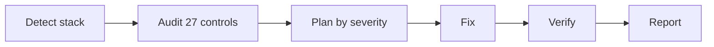

<div align="center">

# 🛡️ Vibe Security Hardening

**27-control pre-launch security audit for AI-built web apps**

فحص أمني من 27 بندًا لتأمين المواقع المبنية بالذكاء الاصطناعي قبل الإطلاق


[English](#english) · [العربية](#العربية)

</div>

---

## English

A single `SKILL.md` that turns any LLM into a security reviewer for your own project. It detects the stack, audits 27 controls with evidence, applies minimal fixes, verifies them, and returns a report.

### Works with

| Host | How |
|---|---|
| Claude (skills) | Add `SKILL.md` as a skill |
| Claude Code | Copy the folder to `.claude/skills/vibe-security-hardening/` |
| ChatGPT, Gemini, DeepSeek, Qwen, Llama, others | Paste `SKILL.md` as the system or first message |
| Cursor, Windsurf, other coding agents | Add `SKILL.md` to the project rules |

### Quick start

```text
Apply the 27-control hardening workflow to my project.
Stack: <framework, database, hosting>
```

### Workflow



### The 27 controls

| # | Control | Group |
|--:|---|---|
| 1 | Secure login | Identity |
| 2 | Hide API keys | Secrets |
| 3 | Secure the database | Data |
| 4 | Force HTTPS | Transport |
| 5 | Hash passwords (Argon2id) | Identity |
| 6 | Server-side validation | Data |
| 7 | XSS protection | Data |
| 8 | Monitor suspicious activity | Operations |
| 9 | Lock admin pages | Identity |
| 10 | Parameterized queries | Data |
| 11 | Review environment variables | Secrets |
| 12 | Rate limiting | Operations |
| 13 | Restrict CORS | Transport |
| 14 | Security headers | Transport |
| 15 | Secure cookies | Identity |
| 16 | CSRF protection | Identity |
| 17 | Expiring password-reset links | Identity |
| 18 | Limit upload type and size | Data |
| 19 | Verify prices and payments on the server | Data |
| 20 | Debug off in production | Operations |
| 21 | Update vulnerable dependencies | Operations |
| 22 | Remove unused dependencies | Operations |
| 23 | No exposed files | Operations |
| 24 | Scan Git history for leaked keys | Secrets |
| 25 | Revoke and rotate exposed keys | Secrets |
| 26 | Full security review | Review |
| 27 | Test the protection and report | Review |

### Output

```text
SECURITY REPORT — <project> — <date>
Summary: X pass / Y fixed / Z open / N n-a
| # | Control | Status | Severity | Evidence | Fix applied | Verification |
```

### Scope

Defensive use on your own project only. It is a hardening pass, not a guarantee and not a substitute for a professional penetration test.

---

<div dir="rtl">

## العربية

ملف `SKILL.md` واحد يحوّل أي نموذج ذكاء اصطناعي إلى مراجع أمني لمشروعك: يكشف التقنيات، يدقّق 27 بندًا بالأدلة، يطبّق أصغر إصلاح ممكن، يتحقق منه، ثم يعطيك تقريرًا.

### يعمل مع

| المنصة | الطريقة |
|---|---|
| Claude (المهارات) | أضف `SKILL.md` كمهارة |
| Claude Code | انسخ المجلد إلى `.claude/skills/vibe-security-hardening/` |
| ChatGPT و Gemini و DeepSeek و Qwen و Llama وغيرها | الصق `SKILL.md` كرسالة نظام أو أول رسالة |
| Cursor و Windsurf وغيرها | أضف `SKILL.md` إلى قواعد المشروع |

### البداية السريعة

```text
طبّق فحص الـ27 بندًا على مشروعي.
التقنيات: <الإطار، قاعدة البيانات، الاستضافة>
```

### البنود الـ27

| # | البند |
|--:|---|
| 1 | تسجيل دخول آمن |
| 2 | إخفاء مفاتيح API |
| 3 | تأمين قاعدة البيانات |
| 4 | HTTPS إجباري |
| 5 | تشفير كلمات المرور |
| 6 | التحقق من النماذج من جهة السيرفر |
| 7 | الحماية من XSS |
| 8 | مراقبة النشاط المشبوه |
| 9 | قفل صفحات الأدمن |
| 10 | Parameterized Queries |
| 11 | مراجعة متغيرات البيئة |
| 12 | Rate Limiting |
| 13 | تقييد CORS |
| 14 | Security Headers |
| 15 | تأمين الكوكيز |
| 16 | حماية CSRF |
| 17 | انتهاء روابط استعادة كلمة المرور |
| 18 | تحديد نوع وحجم الملفات المرفوعة |
| 19 | التحقق من الأسعار والمدفوعات |
| 20 | قفل Debug في الإنتاج |
| 21 | تحديث المكتبات ذات الثغرات |
| 22 | حذف المكتبات غير المستخدمة |
| 23 | منع الملفات المكشوفة |
| 24 | فحص تاريخ Git عن مفاتيح مسرّبة |
| 25 | إلغاء المفاتيح المكشوفة وتبديلها |
| 26 | مراجعة أمنية كاملة |
| 27 | اختبار الحماية وتقرير بكل مشكلة وحلها |

### النطاق

للاستخدام الدفاعي على مشروعك فقط. هذا فحص تقوية وليس ضمانًا ولا بديلًا عن اختبار اختراق احترافي.

</div>

---

<div align="center">

Checklist topics inspired by a short video from <code>m.bin_bushra</code>. Control details written independently.

MIT License

</div>
