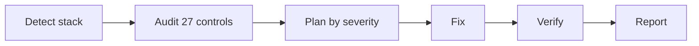

<div align="center">

# 🛡️ Vibe Security Hardening

**Scan, secure, encrypt, protect and monitor AI-built web apps before launch**

فحص وتأمين وتشفير وحماية المواقع المبنية بالذكاء الاصطناعي قبل الإطلاق


[English](#english) · [العربية](#العربية)

</div>

---

## English

A single `SKILL.md` that turns any LLM into a security reviewer for your own project. It detects the stack, audits 27 controls with evidence, applies minimal fixes, verifies them, and returns a report.

### What it covers

| Layer | Contents |
|---|---|
| Automated scanner | `scripts/scan.py` finds leaked keys (files + git history), exposed files, public env misuse, dangerous code, missing RLS, vulnerable dependencies, and live-site header/cookie/CORS/HTTPS/exposed-path issues. GitHub Actions template runs it on every push |
| 27 core controls | Login, secrets, database, input, transport, headers, abuse, dependencies, review |
| Module E: Encryption (E1–E9) | Sensitive-data map encrypted by default, XChaCha20-Poly1305 maximum-strength profile with HKDF per-field keys and peppered Argon2id, TLS, internal TLS, encryption at rest, field-level AES-256-GCM with blind index, key management and rotation, token signing, encrypted backups, front-end build hardening |
| Module D: Intrusion alerts (D1–D9) | Detects SQL injection, XSS, traversal, command injection, SSRF, probes for `.env`/`.git`, brute force and honeytoken use; blocks the request and emails the attack type, IP, approximate location, path and recommended action (throttled, secrets masked) |
| Module A: AI app security (A1–A11) | OWASP GenAI LLM Top 10 2026: prompt injection, data leaks, agent/MCP tool permissions, cost limits, vector store isolation, safe output rendering |
| Module S: Stack playbooks | Ready fixes for Next.js, Supabase, Firebase, Vercel, Laravel, Django, Express, PHP/WordPress, mobile |
| Module K: Saudi PDPL (K1–K12) | Consent, Arabic privacy notice, data rights, retention, 72-hour breach notification to SDAIA, cross-border transfers |
| Module P: Active protection (P1–P7) | CDN/WAF and DDoS, bot challenge, admin MFA and allow-list, breached-password blocking, tested backups, incident kill switch, signed private media |

Includes tested reference encryption code for Node.js and Python, plus a safe plan for migrating existing plaintext data.

### Install

**Claude (web / desktop / mobile)**
1. Download [`dist/vibe-security-hardening.zip`](dist/vibe-security-hardening.zip).
2. Open **Customize > Skills**, click **+**, then **Upload a skill**, and select the ZIP (remove an older version first).
3. Toggle the skill on.

**Claude Code**
```bash
git clone https://github.com/masari-aii/vibe-security-hardening ~/.claude/skills/vibe-security-hardening
```
Use `.claude/skills/vibe-security-hardening/` inside a project to scope it to that project.

**Any other model (ChatGPT, Gemini, DeepSeek, Qwen, Llama...)**
Paste the full content of [`ALL-IN-ONE.md`](ALL-IN-ONE.md) as the system prompt, custom instructions, or first message.

**Coding agents (Cursor, Windsurf, others)**
Copy the repo folder into the project (or add `ALL-IN-ONE.md`) and reference it in the project rules or reference the file in your prompt.

### Usage

Run the scanner yourself (Python 3.8+, no installs):
```bash
python3 scripts/scan.py /path/to/project --url https://your-site.com
```


Full audit and fix:
```text
Secure, encrypt and protect my project: run the 27 controls plus modules E and P.
Stack: Next.js + Supabase + Vercel
```

Audit only, no changes:
```text
Audit my project against the 27 controls. Report only, do not modify files.
```

One group or one control:
```text
Run controls 2, 11, 24, 25 (secrets) on this repo.
```

Chat without file access: paste the relevant files (auth, API routes, DB rules, config) with the request.

What you get back: PASS / FAIL / N/A per control with file and line evidence, fixes ordered by severity, a verification test for each fix, and a list of steps only you can do (key rotation, hosting settings).

### Workflow



### The 27 controls

| # | Control | Group |
|--:|---|---|
| 1 | Secure login | Identity |
| 2 | Hide API keys | Secrets |
| 3 | Secure the database | Data |
| 4 | Force HTTPS | Transport |
| 5 | Hash passwords (Argon2id) | Identity |
| 6 | Server-side validation | Data |
| 7 | XSS protection | Data |
| 8 | Monitor suspicious activity | Operations |
| 9 | Lock admin pages | Identity |
| 10 | Parameterized queries | Data |
| 11 | Review environment variables | Secrets |
| 12 | Rate limiting | Operations |
| 13 | Restrict CORS | Transport |
| 14 | Security headers | Transport |
| 15 | Secure cookies | Identity |
| 16 | CSRF protection | Identity |
| 17 | Expiring password-reset links | Identity |
| 18 | Limit upload type and size | Data |
| 19 | Verify prices and payments on the server | Data |
| 20 | Debug off in production | Operations |
| 21 | Update vulnerable dependencies | Operations |
| 22 | Remove unused dependencies | Operations |
| 23 | No exposed files | Operations |
| 24 | Scan Git history for leaked keys | Secrets |
| 25 | Revoke and rotate exposed keys | Secrets |
| 26 | Full security review | Review |
| 27 | Test the protection and report | Review |

### Output

```text
SECURITY REPORT — <project> — <date>
Summary: X pass / Y fixed / Z open / N n-a
| # | Control | Status | Severity | Evidence | Fix applied | Verification |
```

### Scope

Defensive use on your own project only. It is a hardening pass, not a guarantee and not a substitute for a professional penetration test.

---

<div dir="rtl">

## العربية

ملف `SKILL.md` واحد يحوّل أي نموذج ذكاء اصطناعي إلى مراجع أمني لمشروعك: يكشف التقنيات، يدقّق 27 بندًا بالأدلة، يطبّق أصغر إصلاح ممكن، يتحقق منه، ثم يعطيك تقريرًا.

### ما هي؟

كثير من المواقع المبنية بالـ vibe coding تعمل جيدًا لكنها تُطلق بثغرات شائعة: مفاتيح API ظاهرة في المتصفح، قاعدة بيانات مفتوحة، صفحات أدمن بلا حماية، أسعار يتحكم بها العميل، وبيانات حساسة مخزّنة بدون تشفير. هذه المهارة تعطي النموذج منهجًا ثابتًا بدل الأسئلة العشوائية:

1. **الكشف**: يتعرّف على الإطار وقاعدة البيانات والمصادقة والاستضافة والدفع، ويختار دليل الإصلاح المناسب لتقنيتك.
2. **التدقيق**: يشغّل الفاحص الآلي أولًا، ثم يمرّ على البنود الـ27 ثم وحدات التشفير (E1–E9) والحماية (P1–P7) وكشف الاختراق (D1–D9)، وأمان الذكاء الاصطناعي (A) ونظام حماية البيانات السعودي (K) عند الحاجة، ولكل بند حالة (ناجح / فاشل / لا ينطبق) مع الدليل: الملف ورقم السطر.
3. **الخطة**: يرتّب المشاكل حسب الخطورة (حرج، عالٍ، متوسط، منخفض).
4. **الإصلاح والتشفير**: أصغر تعديل ممكن دون كسر ما يعمل، مع تشفير الحقول الحساسة وتفعيل طبقات الحماية.
5. **التحقق**: اختبار فعلي لكل إصلاح.
6. **التقرير**: جدول بكل مشكلة وكيف حُلّت وما المتبقي عليك.

### ماذا تغطي؟

| الطبقة | المحتوى |
|---|---|
| 27 بندًا أساسيًا | الدخول، المفاتيح، قاعدة البيانات، المدخلات، النقل، الهيدرز، منع الإساءة، المكتبات، المراجعة |
| وحدة التشفير E1–E9 | خريطة للبيانات الحساسة تُشفَّر تلقائيًا، ملف أقصى قوة بـ XChaCha20-Poly1305 ومفتاح مستقل لكل حقل وكلمات مرور Argon2id مع pepper، HTTPS، تشفير الاتصالات الداخلية، التشفير على مستوى التخزين، تشفير الحقول الحساسة بـ AES-256-GCM مع فهرس بحث آمن، إدارة المفاتيح وتدويرها، توقيع التوكنات، تشفير النسخ الاحتياطية، تقوية كود الواجهة |
| وحدة كشف الاختراق D1–D9 | يكتشف حقن SQL و XSS وتجاوز المسارات وحقن الأوامر و SSRF ومحاولات الوصول لـ `.env` و `.git` وتخمين كلمات المرور واستخدام البيانات الفخ؛ يحجب الطلب ويرسل إيميل فيه نوع الهجوم وعنوان IP والموقع التقريبي والصفحة المستهدفة والإجراء المقترح |
| الفاحص الآلي | سكربت `scripts/scan.py` يكشف المفاتيح المسرّبة (في الملفات وتاريخ Git)، الملفات المكشوفة، المتغيرات السرية الظاهرة للمتصفح، الكود الخطر، الجداول بدون RLS، المكتبات المصابة، ومشاكل الموقع المباشر (الهيدرز، الكوكيز، CORS، HTTPS، المسارات المكشوفة). مع ملف GitHub Actions يشغّله عند كل رفع |
| وحدة أمان تطبيقات الذكاء الاصطناعي A1–A11 | حسب OWASP GenAI LLM Top 10 2026: حقن الأوامر، تسريب البيانات، صلاحيات الوكلاء وأدوات MCP، سقف التكلفة، عزل قواعد المتجهات، العرض الآمن للمخرجات |
| أدلة حسب التقنية | إصلاحات جاهزة لـ Next.js و Supabase و Firebase و Vercel و Laravel و Django و Express و PHP/WordPress وتطبيقات الجوال |
| وحدة نظام حماية البيانات الشخصية السعودي K1–K12 | الموافقة، سياسة خصوصية بالعربي، حقوق صاحب البيانات، مدة الاحتفاظ، إبلاغ سدايا عن التسرّب خلال 72 ساعة، نقل البيانات خارج المملكة |
| وحدة الحماية P1–P7 | جدار حماية CDN/WAF وصد DDoS، تحدي البوتات، MFA للأدمن، منع كلمات المرور المسرّبة، نسخ احتياطي مُختبر، زر طوارئ لإلغاء الجلسات والمفاتيح، روابط موقّعة للملفات الخاصة |

تتضمن كود تشفير مُختبرًا لـ Node.js و Python، وخطة آمنة لتشفير البيانات الموجودة حاليًا بدون تشفير.

> عن نظام حماية البيانات: الوحدة K قائمة تقنية تساعدك على الامتثال، وليست استشارة قانونية.

> عن التنبيهات: الموقع الجغرافي من عنوان IP تقريبي، والمهاجم قد يستخدم VPN، فالإيميل يوضح من أين جاء الهجوم لا هوية الشخص.

> تنبيه: كود الواجهة الذي يصل للمتصفح يمكن قراءته دائمًا؛ التشويش يبطّئ النسخ فقط. المهارة تنقل الأسرار ومنطق العمل إلى السيرفر.

### التركيب

**Claude (الويب / سطح المكتب / الجوال)**
1. نزّل الملف [`dist/vibe-security-hardening.zip`](dist/vibe-security-hardening.zip).
2. افتح **Customize > Skills** ثم **+** ثم **Upload a skill** واختر الملف (احذف النسخة القديمة أولًا).
3. فعّل المهارة.

**Claude Code**
```bash
git clone https://github.com/masari-aii/vibe-security-hardening ~/.claude/skills/vibe-security-hardening
```
ضعها في `.claude/skills/vibe-security-hardening/` داخل المشروع لتخصيصها لذلك المشروع فقط.

**أي نموذج آخر (ChatGPT و Gemini و DeepSeek و Qwen و Llama...)**
الصق محتوى [`ALL-IN-ONE.md`](ALL-IN-ONE.md) كاملًا كتعليمات النظام أو التعليمات المخصصة أو أول رسالة.

**وكلاء البرمجة (Cursor و Windsurf وغيرها)**
انسخ مجلد المستودع داخل المشروع (أو أضف `ALL-IN-ONE.md`) وأشر إليه في قواعد المشروع.

### الاستخدام

شغّل الفاحص بنفسك (Python 3.8 أو أحدث، بدون تثبيت أي شيء):
```bash
python3 scripts/scan.py /path/to/project --url https://your-site.com
```


فحص وإصلاح كامل:
```text
أمّن وشفّر واحمِ مشروعي: طبّق الـ27 بندًا ووحدتي التشفير والحماية.
التقنيات: Next.js + Supabase + Vercel
```

فحص فقط دون تعديل:
```text
افحص مشروعي على البنود الـ27 وأعطني تقريرًا فقط، لا تعدّل أي ملف.
```

مجموعة أو بنود محددة:
```text
نفّذ البنود 2 و11 و24 و25 (المفاتيح والأسرار) على هذا المستودع.
```

في محادثة بلا وصول للملفات: الصق الملفات المهمة (المصادقة، مسارات API، قواعد قاعدة البيانات، الإعدادات) مع الطلب.

**ما الذي تحصل عليه؟** حالة كل بند مع الدليل، الإصلاحات مرتبة حسب الخطورة، اختبار تحقق لكل إصلاح، وقائمة بما يلزمك أنت فعله (تبديل المفاتيح، إعدادات الاستضافة).

**نصائح**
- شغّلها قبل كل إطلاق وبعد كل ميزة كبيرة.
- جرّب على نسخة محلية أو staging، لا على الإنتاج.
- أي مفتاح ظهر في Git أو المتصفح يُعتبر مسرّبًا: بدّله من المزوّد، حذف السطر لا يكفي.

### البنود الـ27

| # | البند |
|--:|---|
| 1 | تسجيل دخول آمن |
| 2 | إخفاء مفاتيح API |
| 3 | تأمين قاعدة البيانات |
| 4 | HTTPS إجباري |
| 5 | تشفير كلمات المرور |
| 6 | التحقق من النماذج من جهة السيرفر |
| 7 | الحماية من XSS |
| 8 | مراقبة النشاط المشبوه |
| 9 | قفل صفحات الأدمن |
| 10 | Parameterized Queries |
| 11 | مراجعة متغيرات البيئة |
| 12 | Rate Limiting |
| 13 | تقييد CORS |
| 14 | Security Headers |
| 15 | تأمين الكوكيز |
| 16 | حماية CSRF |
| 17 | انتهاء روابط استعادة كلمة المرور |
| 18 | تحديد نوع وحجم الملفات المرفوعة |
| 19 | التحقق من الأسعار والمدفوعات |
| 20 | قفل Debug في الإنتاج |
| 21 | تحديث المكتبات ذات الثغرات |
| 22 | حذف المكتبات غير المستخدمة |
| 23 | منع الملفات المكشوفة |
| 24 | فحص تاريخ Git عن مفاتيح مسرّبة |
| 25 | إلغاء المفاتيح المكشوفة وتبديلها |
| 26 | مراجعة أمنية كاملة |
| 27 | اختبار الحماية وتقرير بكل مشكلة وحلها |

### النطاق

للاستخدام الدفاعي على مشروعك فقط. هذا فحص تقوية وليس ضمانًا ولا بديلًا عن اختبار اختراق احترافي.

</div>

---

<div align="center">

Checklist topics inspired by a short video from <code>m.bin_bushra</code>. Control details written independently.

MIT License

</div>
